# The Tower

This is a game that baffles everyone who sees me playing it. I'm sure they'd
be even more baffled to discover I've been tracking my matches to discern any
signs of progress. I was able to gain some insights from this spreadsheet
itself, but I knew I wanted to eventually generate some scatter plots and
trend lines. Here it is.

## Links about the game

- [The Tower on the Google Play store](https://play.google.com/store/apps/details?id=com.TechTreeGames.TheTower&hl=en_US)
- [The Tower on the Apple App Store](https://apps.apple.com/us/app/the-tower-idle-tower-defense/id1575590830)
- [Notion wiki for The Tower](https://the-tower.notion.site/)
- [Tech Tree Games](https://www.techtreegames.com/) build a variety of idle games.

## Recent Statistics

The tables in this section are generated by `analyze-playlog.R` and reflect
the latest data that I've entered into the spreadsheet and then imported into
this repo.

<!-- RECENT-STATS-START -->

<!-- Auto-generated by analyze-playlog.R — do not edit between these markers -->

### Recent Statistics (Jun 2026 – Oct 2026)

| Tier | Games | Total Coins (B) | Avg Duration | Max Duration | Avg Coins (B) | Max Coins (B) | Avg Min/B | Avg Coins/Hr |
| ----- | ------: | --------------: | -----------: | -----------: | --------------: | --------------: | ----------: | -------------: |
| 16 | 2 | 51.2 | 0h10m | 0h15m | 25.6 | 34.9 | 0.35 | 182.0 |
| 15 | 13 | 134.0 | 0h18m | 0h26m | 10.3 | 78.2 | 4.53 | 31.4 |
| 14 | 8 | 888.6 | 0h57m | 1h49m | 111.1 | 595.0 | 2.60 | 83.3 |
| 13 | 25 | 2,527.2 | 2h02m | 3h25m | 101.1 | 1340.0 | 3.37 | 38.0 |
| 12 | 17 | 9,139.4 | 4h56m | 6h11m | 537.6 | 3420.0 | 1.05 | 107.8 |
| 11 | 24 | 55,744.4 | 8h04m | 8h45m | 2322.7 | 21630.0 | 0.34 | 285.4 |
| 10 | 58 | 126,705.0 | 9h57m | 10h17m | 2184.6 | 7800.0 | 0.31 | 221.6 |
| 9 | 23 | 51,148.3 | 11h01m | 11h47m | 2223.8 | 7100.0 | 0.34 | 203.7 |
| 8 | 27 | 80,262.9 | 11h49m | 12h51m | 2972.7 | 13350.0 | 0.30 | 255.0 |
| 7 | 18 | 48,903.0 | 12h54m | 13h30m | 2716.8 | 3610.0 | 0.29 | 211.0 |
| 6 | 19 | 78,400.0 | 15h04m | 15h39m | 4126.3 | 10590.0 | 0.24 | 277.6 |
| 5 | 7 | 38,297.8 | 15h56m | 17h16m | 5471.1 | 10480.0 | 0.23 | 351.9 |
| 4 | 1 | 14,480.0 | 16h29m | 16h29m | 14480.0 | 14480.0 | 0.07 | 878.8 |
| **All** | **242** | **506,681.8** | **8h50m** | **17h16m** | **2093.7** | **21630.0** | **0.98** | **198.0** |

<!-- RECENT-STATS-END -->

<!-- RECENT-TOURNAMENT-STATS-START -->

<!-- Auto-generated by analyze-playlog.R — do not edit between these markers -->

### Recent Tournament Statistics (Apr 2026 – Oct 2026)

| Tier | Games | Total Coins (B) | Avg Duration | Max Duration | Avg Coins (B) | Max Coins (B) | Avg Wave | Max Wave |
| ----- | ------: | --------------: | -----------: | -----------: | --------------: | --------------: | ------: | ------: |
| T-12 | 10 | 158.8 | 0h27m | 0h54m | 15.9 | 63.5 | 611 | 772 |
| T-8 | 73 | 3,422.5 | 2h24m | 3h20m | 46.9 | 326.4 | 1719 | 2418 |
| **All** | **83** | **3,581.3** | **2h10m** | **3h20m** | **43.1** | **326.4** | **1585** | **2418** |

<!-- RECENT-TOURNAMENT-STATS-END -->

## Regular Plays Analysis

Graphs generated from playlog data:

Attack dissonant runs appear as triangles; trend lines and labels use
regular runs only.

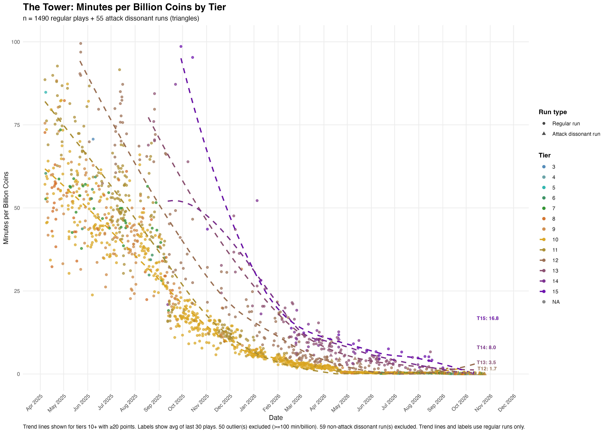

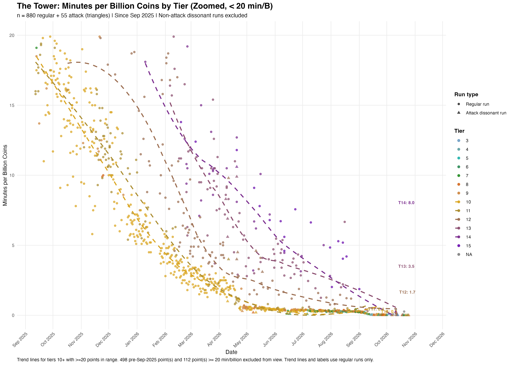

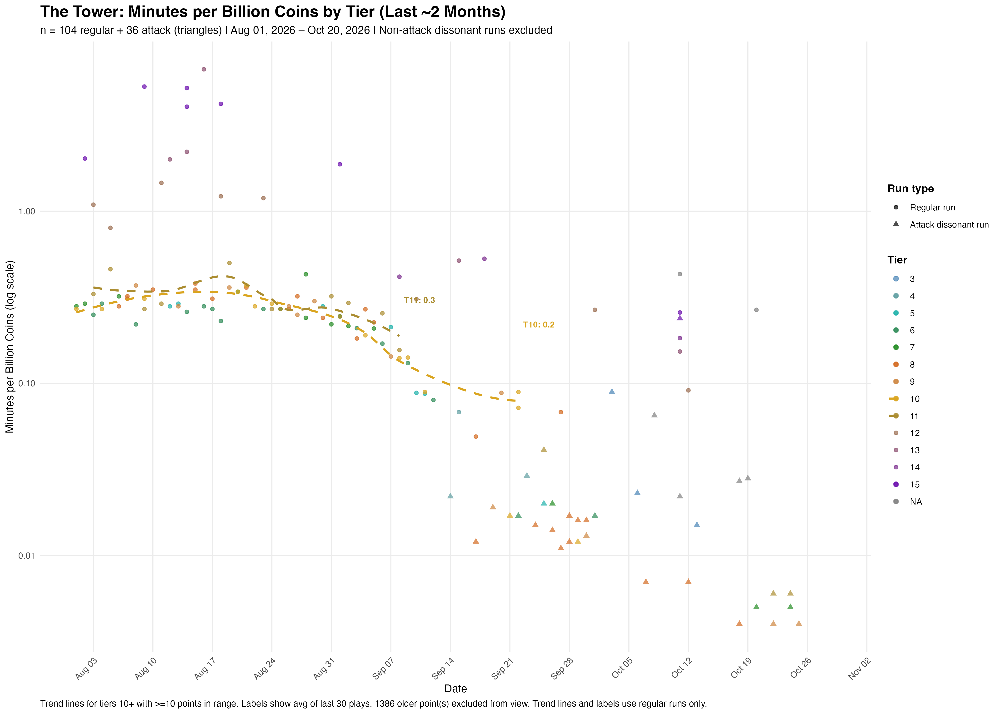

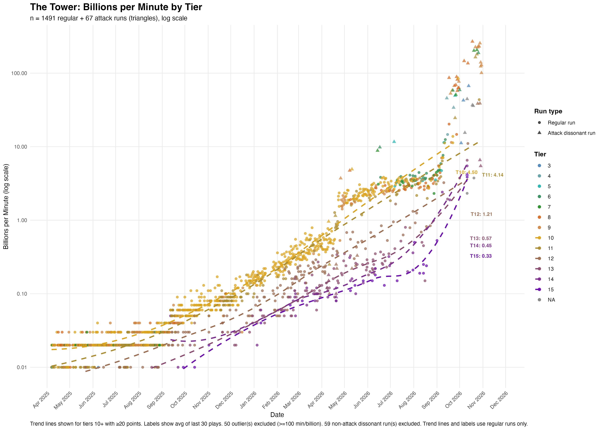

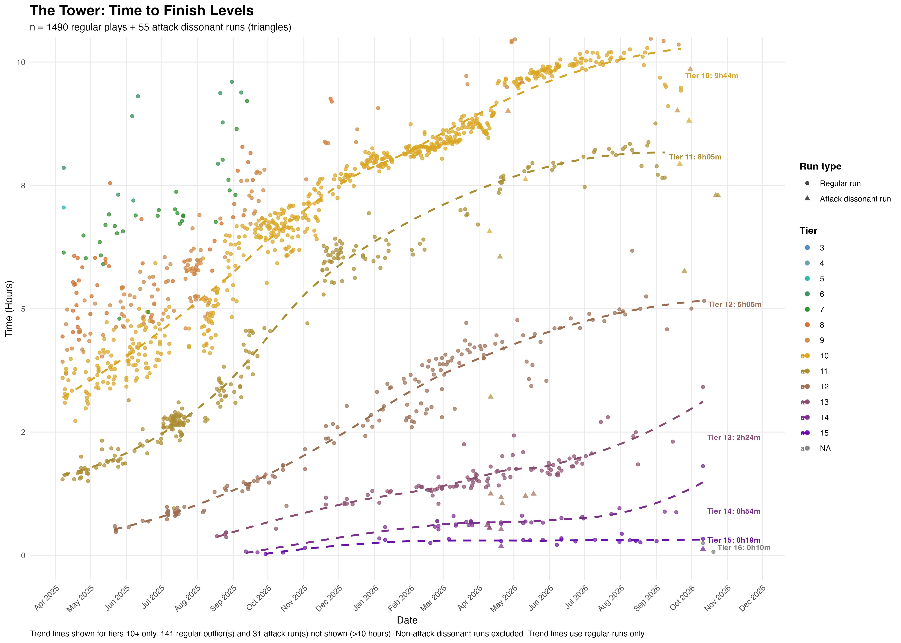

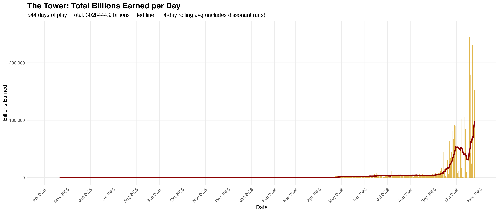

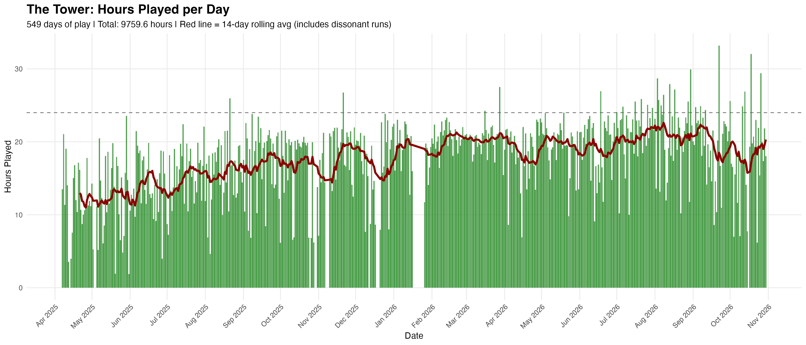

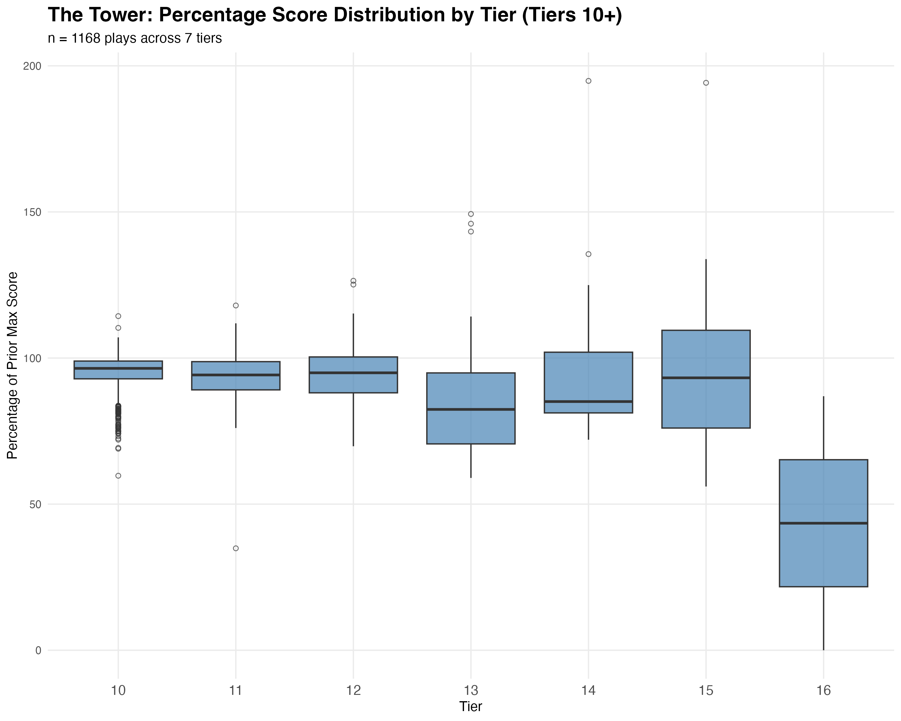

## Tournament Analysis

Tournaments are special events tracked as negative tier numbers. Analysis only includes tiers with 10+ plays.

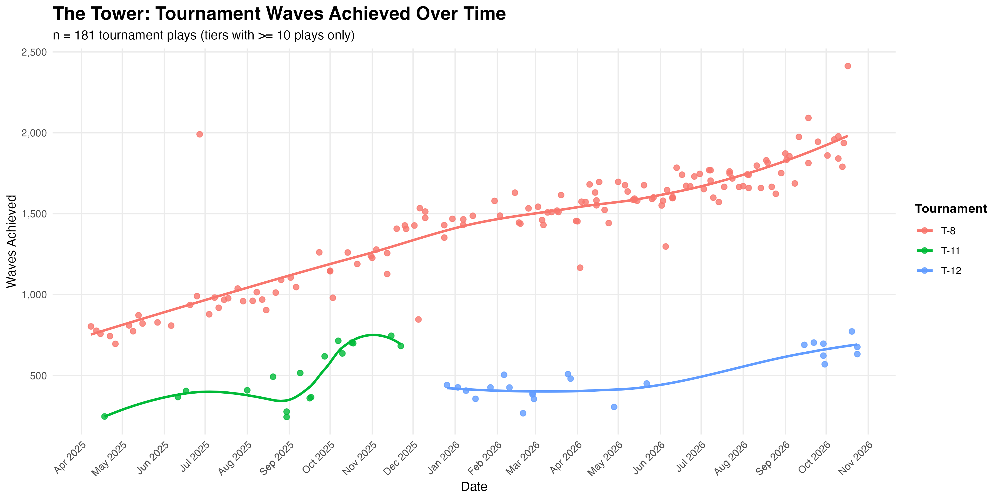

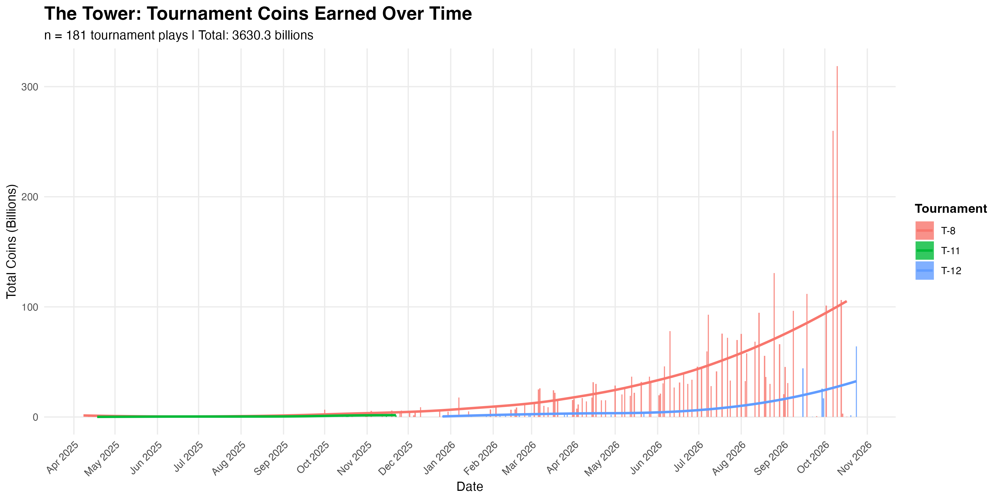

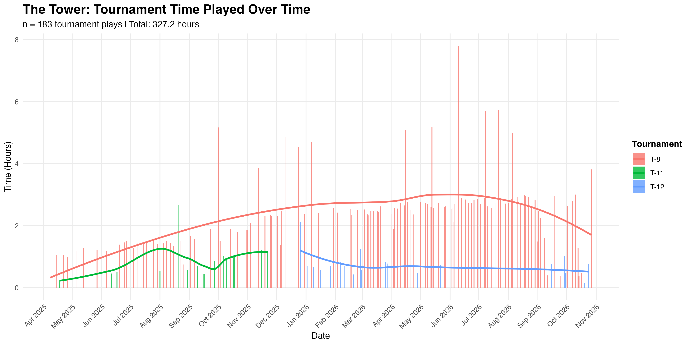

## Dissonant Run Analysis

The table below is generated by `analyze-playlog.R` and shows the latest
dissonant run per tier and category. `Pct of Max` is the finish wave as a
percentage of the max wave for that tier, and `Days Since` is how long it
has been since that run was done.

<!-- RECENT-DISSONANT-STATS-START -->

<!-- Auto-generated by analyze-playlog.R — do not edit between these markers -->

### Recent Dissonant Run Statistics (as of 2026-10-30)

Latest dissonant run per tier and category. `Pct of Max` = Finish Wave / Max Wave for that tier.

| Tier | Category | Last Run | Finish Wave | Max Wave | Pct of Max | Days Since |
| ----- | -------- | -------- | ----------: | -------: | ---------: | ---------: |
| 15 | Attack | 2026-10-11 | 163 | 327 | 49.8% | 19 |
| 14 | Attack | 2026-04-20 | 104 | 493 | 21.1% | 193 |
| 14 | Defense | 2026-04-13 | 34 | 493 | 6.9% | 200 |
| 14 | Utility | 2026-04-20 | 226 | 493 | 45.8% | 193 |
| 14 | Ultimate Weapons | 2026-04-13 | 298 | 493 | 60.4% | 200 |
| 13 | Attack | 2026-10-29 | 769 | 4074 | 18.9% | 1 |
| 13 | Defense | 2026-10-20 | 545 | 2718 | 20.1% | 10 |
| 13 | Utility | 2026-04-10 | 611 | 1460 | 41.8% | 203 |
| 13 | Ultimate Weapons | 2026-04-10 | 581 | 1460 | 39.8% | 203 |
| 12 | Attack | 2026-10-28 | 3485 | 4074 | 85.5% | 2 |
| 12 | Defense | 2026-05-18 | 720 | 3118 | 23.1% | 165 |
| 12 | Utility | 2026-05-18 | 1828 | 3118 | 58.6% | 165 |
| 12 | Ultimate Weapons | 2026-05-18 | 1387 | 3118 | 44.5% | 165 |
| 11 | Attack | 2026-10-24 | 5736 | 6187 | 92.7% | 6 |
| 11 | Defense | 2026-10-22 | 3308 | 6187 | 53.5% | 8 |
| 11 | Utility | 2026-10-23 | 4240 | 6187 | 68.5% | 7 |
| 11 | Ultimate Weapons | 2026-10-23 | 4781 | 6187 | 77.3% | 7 |
| 10 | Attack | 2026-09-29 | 6879 | 7569 | 90.9% | 31 |
| 10 | Defense | 2026-10-21 | 4715 | 7569 | 62.3% | 9 |
| 10 | Utility | 2026-10-23 | 5209 | 7569 | 68.8% | 7 |
| 10 | Ultimate Weapons | 2026-09-21 | 5464 | 7569 | 72.2% | 39 |
| 9 | Attack | 2026-10-30 | 7165 | 9198 | 77.9% | 0 |
| 9 | Defense | 2026-10-21 | 5183 | 8160 | 63.5% | 9 |
| 9 | Utility | 2026-09-18 | 5200 | 8160 | 63.7% | 42 |
| 9 | Ultimate Weapons | 2026-09-18 | 6056 | 8160 | 74.2% | 42 |
| 8 | Attack | 2026-10-18 | 9779 | 9737 | 100.4% | 12 |
| 8 | Defense | 2026-10-21 | 5334 | 9779 | 54.5% | 9 |
| 8 | Utility | 2026-09-15 | 5320 | 8788 | 60.5% | 45 |
| 8 | Ultimate Weapons | 2026-09-16 | 6643 | 8788 | 75.6% | 44 |
| 7 | Attack | 2026-10-24 | 11461 | 11169 | 102.6% | 6 |
| 7 | Defense | 2026-10-02 | 5184 | 9450 | 54.9% | 28 |
| 7 | Utility | 2026-10-15 | 6414 | 9450 | 67.9% | 15 |
| 7 | Ultimate Weapons | 2026-06-13 | 6087 | 6096 | 99.9% | 139 |
| 6 | Attack | 2026-10-26 | 13908 | 11723 | 118.6% | 4 |
| 6 | Defense | 2026-10-14 | 5526 | 11723 | 47.1% | 16 |
| 6 | Utility | 2026-06-15 | 5605 | 6344 | 88.4% | 137 |
| 6 | Ultimate Weapons | 2026-06-16 | 7173 | 6344 | 113.1% | 136 |
| 5 | Attack | 2026-09-25 | 12077 | 11955 | 101.0% | 35 |
| 5 | Defense | 2026-10-13 | 5708 | 12077 | 47.3% | 17 |
| 5 | Utility | 2026-07-03 | 6064 | 6378 | 95.1% | 119 |
| 5 | Ultimate Weapons | 2026-07-04 | 7862 | 6378 | 123.3% | 118 |
| 4 | Attack | 2026-09-23 | 13035 | 13010 | 100.2% | 37 |
| 4 | Defense | 2026-10-14 | 5559 | 13035 | 42.6% | 16 |
| 4 | Utility | 2026-09-12 | 6890 | 6459 | 106.7% | 48 |
| 4 | Ultimate Weapons | 2026-09-13 | 10003 | 6890 | 145.2% | 47 |
| 3 | Attack | 2026-10-13 | 15212 | 14506 | 104.9% | 17 |
| 3 | Defense | 2026-10-04 | 5489 | 13017 | 42.2% | 26 |
| 3 | Utility | 2026-10-04 | 8433 | 13017 | 64.8% | 26 |
| 3 | Ultimate Weapons | 2026-10-05 | 12189 | 13017 | 93.6% | 25 |
| 2 | Attack | 2026-10-11 | 14866 | 14800 | 100.4% | 19 |
| 2 | Defense | 2026-10-09 | 5549 | 14800 | 37.5% | 21 |
| 2 | Utility | 2026-10-09 | 9577 | 14800 | 64.7% | 21 |
| 2 | Ultimate Weapons | 2026-10-10 | 13620 | 14800 | 92.0% | 20 |
| 1 | Attack | 2026-10-19 | 15523 | 15322 | 101.3% | 11 |
| 1 | Defense | 2026-10-15 | 6059 | 8722 | 69.5% | 15 |
| 1 | Utility | 2026-10-16 | 11957 | 8722 | 137.1% | 14 |
| 1 | Ultimate Weapons | 2026-10-17 | 15124 | 11957 | 126.5% | 13 |
| **All** | **151 runs** | **2026-10-30** | **15523** | — | **71.8%** | **0** |

<!-- RECENT-DISSONANT-STATS-END -->
